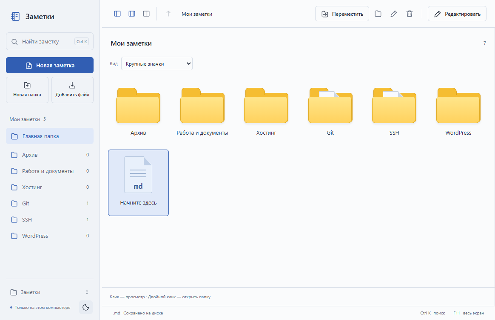
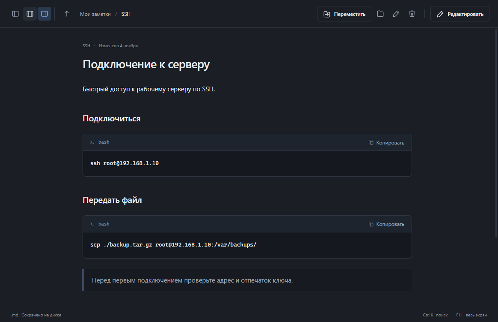
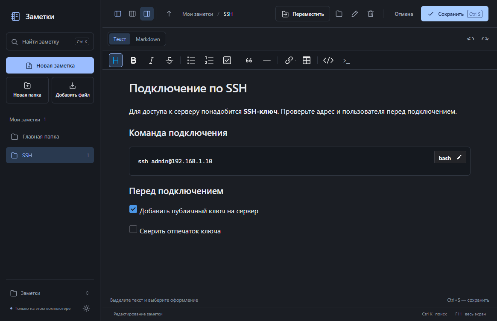

# Заметки — Quiet Notes

Небольшое приложение для Windows 10/11 (64 бита). Заметки — обычные файлы `.md` в выбранной папке. Подпапки становятся темами. Интернет, регистрация и база данных для заметок не используются.

## Самый простой запуск

1. Откройте папку `release` рядом с этой инструкцией.
2. Дважды нажмите `QuietNotes-1.7.0-x64-portable.exe`. Установка, Node.js и другие программы для запуска **не нужны**. Первый запуск может занять до минуты: portable распаковывает встроенные файлы во временную папку Windows.
3. Нажмите **«Выбрать папку с заметками»**. Выберите свою папку с `.md` или создайте пустую. Для знакомства можно выбрать папку `examples` из этого проекта.
4. Слева можно открыть тему. В средней колонке показано содержимое текущей папки: папки открываются двойным кликом, файлы — одним кликом. Выбранная заметка сразу отображается справа. У блоков кода есть кнопка **«Копировать»**, она не запускает команду.

Вариант с установкой: запустите `QuietNotes-1.7.0-x64-nsis.exe` из `release`, выберите папку установки и затем открывайте ярлык **«Заметки»**. Версия не подписана платным сертификатом; Windows может показать неизвестного издателя.

## Виды папок и файлов

Над списком есть переключатель **«Вид»**:

- **Список** — компактный вид с названием и типом файла.
- **Плитки** — папки и заметки в небольших карточках.
- **Крупные значки** — большие жёлтые папки с подписями под ними, как в проводнике Windows.

Кнопки с изображениями панелей слева в верхней строке скрывают и показывают левую панель, список файлов и область просмотра. Скрывайте область просмотра для обзора папок на всю ширину. При открытии заметки область просмотра появляется снова. Выбранный вид и состояние области просмотра запоминаются после закрытия приложения. Перенос мышью и создание файлов работают во всех видах.



## Панели и свободное место

В верхней строке постоянно доступны три кнопки: **«Левая панель»**, **«Список файлов»**, **«Область просмотра»**. Название появляется при наведении. Нажмите кнопку, чтобы скрыть соответствующую панель, и ещё раз — чтобы вернуть. Можно скрыть обе левые панели и читать заметку почти на весь экран. Поиск через Ctrl+K продолжит работать.

Чтобы изменить ширину, потяните вертикальную границу между панелями. При наведении граница подсвечивается. Двойной клик по ней возвращает стандартную ширину. Размеры и видимость сохраняются после перезапуска; текст в редакторе при этом остаётся на месте.



## Контекстное меню

Нажмите правой кнопкой на пустом месте в списке: появятся **«Новая заметка»**, **«Новая папка»** и **«Добавить файл…»**. Новые файлы создаются в открытой папке.

При правом клике на папку те же пункты создают записи **внутри этой папки**, даже если вы её ещё не открыли. На файле или папке также доступны открытие, переименование, перемещение и удаление с подтверждением. Меню работает и у папок в левой панели. Escape закрывает меню без изменений.

## Как пользоваться

- **Поиск:** `Ctrl+K`, затем вводите название или часть текста. Поиск идёт по всем темам, без учёта регистра. Несколько слов должны встретиться в названии или тексте. Стрелки выбирают результат, `Enter` открывает, `Esc` закрывает поиск.
- **Поиск в заметке:** откройте заметку и нажмите `Ctrl+F`. Совпадения подсвечиваются, Enter и Shift+Enter переходят между ними, Esc закрывает поиск.
- **Избранное:** нажмите на заметку правой кнопкой и выберите **«Закрепить в избранном»**. Избранные папки и заметки отмечаются звёздочкой и показываются первыми при открытии папки. Они также доступны слева.
- **Создать заметку:** значок **«Новая заметка»** под поиском. Файл появится в открытой папке, её название видно над списком. Если папка библиотеки ещё не выбрана, приложение сначала предложит выбрать её.
- **Заметка из буфера:** скопируйте текст или Markdown и нажмите значок **«Заметка из буфера»** под поиском либо `Ctrl+Shift+N`. Проверьте текст и папку, введите название и нажмите Enter. Чтобы сохранить сразу в другую папку, нажмите по ней правой кнопкой и выберите **«Новая заметка из буфера…»**.
- **Создать папку:** кнопка **«Новая папка»** слева.
- **Добавить готовый файл:** **«Добавить файл»**, затем выберите один или несколько `.md`. Приложение копирует их в открытую папку, исходники остаются на месте. Файлы с совпадающими названиями не заменяются.
- **Просмотр и навигация:** один клик по папке показывает справа список её заметок и подпапок. Двойной клик или Enter открывает папку в средней колонке. Заметку можно открыть из любого списка. Кнопка со стрелкой вверх или Alt+↑ поднимает на уровень выше. По частям адреса вверху можно переходить к родительским папкам. **«Главная папка»** слева открывает корень библиотеки.
- **Переместить:** выберите заметку или папку в средней колонке, нажмите **«Переместить»**, откройте папку назначения и нажмите **«Переместить сюда»**. Для возврата в корень выберите «Мои заметки» в адресе диалога. Также можно перетащить файл на папку в списке, на тему слева или на часть адреса вверху. Совпадающие названия не затираются; папку нельзя переместить внутрь самой себя.
- **Редактировать:** кнопка справа сверху. Оформите текст кнопками редактора и нажмите **«Сохранить»** или `Ctrl+S`.
- **Переименовать:** кнопка с карандашом в верхней панели или `F2` в режиме просмотра.
- **Удалить:** кнопка корзины. Приложение попросит подтверждение и переместит файл или всю выбранную папку в **корзину Windows**.
- **Проводник:** кнопка папки в верхней панели показывает выбранный файл на диске.
- **Другая папка заметок:** нажмите название папки внизу слева.
- **Светлая/тёмная тема:** кнопка солнца или луны внизу слева. По умолчанию включена тёмная тема.
- **Весь экран:** `F11`. Повторное нажатие возвращает обычное окно. Также можно развернуть окно стандартной кнопкой Windows.

Настройки, размер и положение окна, последняя заметка и открытая папка запоминаются. Portable означает запуск без установки: настройки при этом остаются в профиле Windows, а не рядом с `.exe`.

## Визуальный редактор

Нажмите **«Редактировать»**. В режиме **«Текст»** заметка сразу выглядит оформленной. Выделите фразу для жирного, курсива или зачёркивания. Для заголовков, списков, чек-листов, цитат, ссылок и таблиц есть кнопки над текстом.

Чтобы вставить команды, нажмите **«Блок кода»** (значок `>_`) и вставьте текст. После сохранения у блока появится кнопка **«Копировать»**. В узком окне часть инструментов доступна через **«Ещё»**.

Вставляйте скриншоты через `Ctrl+V` в редакторе. Поддерживаются PNG и JPEG до 10 МБ на изображение. При сохранении новые изображения записываются в служебную папку `.quiet-notes-images` в корне библиотеки. Переносите библиотеку целиком, чтобы сохранить вложения. В стороннем редакторе для таких ссылок может понадобиться открыть библиотеку как корневую папку.

**«Markdown»** открывает исходный текст заметки. Через него удобно вставить готовую разметку. Заметки с нестандартной разметкой лучше править в этом режиме: визуальный редактор может переформатировать исходник при сохранении правок.



## Ваши файлы и внешние изменения

Заметки хранятся только там, где вы выбрали. Можно открыть их в Блокноте, другом редакторе или перенести всю папку на другой диск. Приложение читает Markdown в **UTF-8**. Расширения `.md` и `.MD` поддерживаются. Пустые темы видны; скрытые имена, начинающиеся с точки, пропускаются. Ссылки файловой системы и junction-папки внутри библиотеки не обходятся.

Пример структуры:

```text
Мои заметки/
  SSH/
    Подключение.md
  WordPress/
    Установка.md
  Git/
    Ветки.md
```

Когда файл меняется снаружи, просмотр обновляется автоматически. Если вы уже редактируете его и набрали свой текст, приложение показывает предупреждение. Можно **загрузить версию с диска** с подтверждением либо **сохранить свой текст отдельной копией**. Сохранение проверяет версию файла и записывает данные через временный файл в той же папке.

При переходе к другой заметке или закрытии окна несохранённый текст требует решения: сохранить, не сохранять или отменить действие. После аварийного завершения Windows несохранённый текст не восстанавливается — сохраняйте важные правки через `Ctrl+S`.

Поиск использует временный индекс **в оперативной памяти**, который обновляется при изменении файлов. Индекса и базы заметок на диске нет. Файлы больше 10 МБ открывайте во внешнем редакторе; поиск их пропускает. Неизвестный язык кода показывается без подсветки, копирование работает.

Локальные картинки в Markdown поддерживаются по относительному пути внутри выбранной папки (PNG, JPG, GIF, WebP, SVG). Ссылки на другие `.md` открывают заметки. Внешние картинки и загрузки из интернета отключены; внешние ссылки из приложения не открываются. HTML очищается перед показом.

Настройки лежат в `%APPDATA%\Quiet Notes\settings.json`. Для полного сброса закройте приложение и переименуйте этот файл. Заметки при этом останутся на месте. Служебные файлы Electron в профиле Windows не содержат отдельной базы заметок.

## Добавление заметок из ChatGPT

В этом локальном чате помощник может записать обычный `.md`-файл непосредственно в выбранную папку, и приложение подхватит его автоматически. Например: «Сохрани инструкцию по SSH в мою папку заметок».

Универсальное подключение сайта и отдельных приложений ChatGPT пока не включено; по вашему решению оно отложено. В приложении нет встроенного чата, API-ключей или скрытой отправки заметок в интернет.

## Как собрать приложение самостоятельно

Сборка нужна только при изменении исходного кода. Для готовых `.exe` ничего из этого делать не нужно.

1. Установите **Node.js LTS версии 24 или новее** с [официального сайта Node.js](https://nodejs.org/). Оставьте стандартные варианты установки.
2. Убедитесь, что компьютер подключён к интернету: при сборке загружаются Electron и библиотеки. Готовое приложение работает без интернета.
3. Дважды нажмите **`Собрать приложение.cmd`** в папке проекта.
4. Дождитесь сообщения об успешной сборке. Первый раз это может занять несколько минут.
5. В папке `release` появятся portable `.exe` и установщик `.exe`.

Если хотите выполнить сборку вручную: в проводнике откройте папку проекта, в адресной строке напишите `cmd` и нажмите Enter. Затем по очереди выполните:

```bat
npm ci
npm run dist
```

Запуск исходников без упаковки:

```bat
npm ci
npm start
```

Или дважды нажмите **`Запустить из исходников.cmd`**. Он установит библиотеки, если их ещё нет, и откроет приложение.

Если окно сборки сообщает об ошибке загрузки, проверьте подключение и повторите запуск. Если `.exe` занят, закройте запущенную копию приложения перед новой сборкой. Для выпуска 32-битной или ARM-версии нужно отдельно изменить параметры сборки; готовые файлы здесь предназначены для x64.

## Для работы с кодом

Простой JavaScript без серверов и интерфейсных фреймворков:

- `src/main.cjs` — окно, безопасный доступ к файлам, события Windows, наблюдение за папкой.
- `src/store.cjs` — дерево, поиск, сохранение и проверки путей.
- `src/preload.cjs` — ограниченный мост между окном и файловыми операциями.
- `src/renderer.js` — просмотр, сохранение и диалоги.
- `src/editor.js` — визуальный редактор на базе [TOAST UI Editor](https://ui.toast.com/tui-editor/) и режим Markdown.
- `src/explorer.js` — списки папок и файлов, навигация, перетаскивание и выбор папки переноса.
- `src/panels.js` — изменение ширины и скрытие панелей.
- `src/styles.css` — оформление и две темы.
- `scripts/build.cjs` — сборка локальных библиотек в интерфейс.

```bat
npm test
npm run test:ui
```

Первая команда проверяет файловые операции и конфликты. Вторая запускает настоящее приложение и проверяет его основные действия, буфер обмена, тему, внешние изменения, защиту несохранённого текста и окно. Electron запускается с изолированным контекстом, без Node.js в интерфейсе; подход основан на [официальных рекомендациях Electron](https://www.electronjs.org/docs/latest/tutorial/security).

## Исходники

Проект: [cry4death/QuietNotes](https://github.com/cry4death/QuietNotes). Пользовательские заметки, настройки Windows, временные файлы и результаты сборки в репозиторий не добавляются. В `examples` находятся только учебные заметки.
